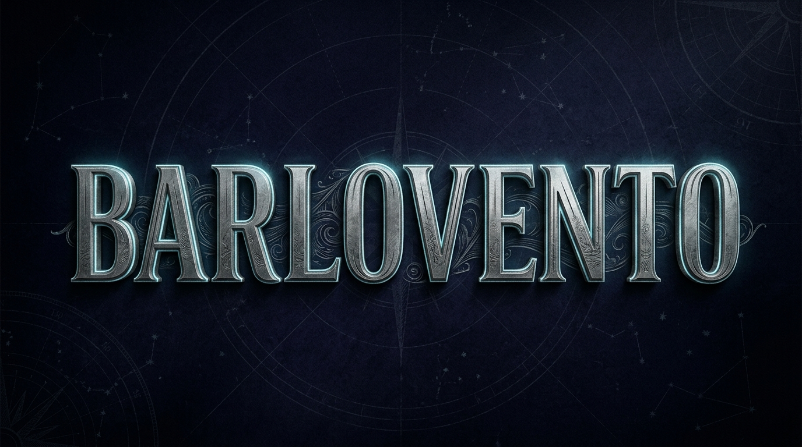
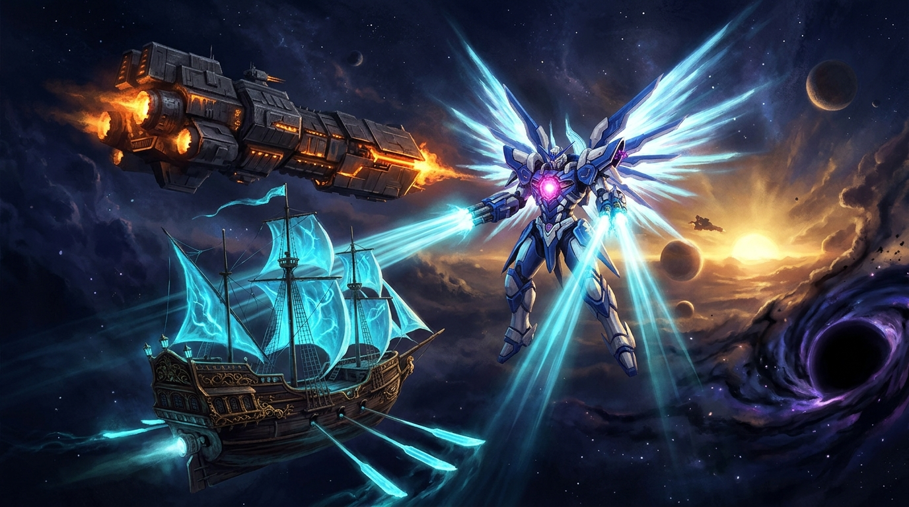
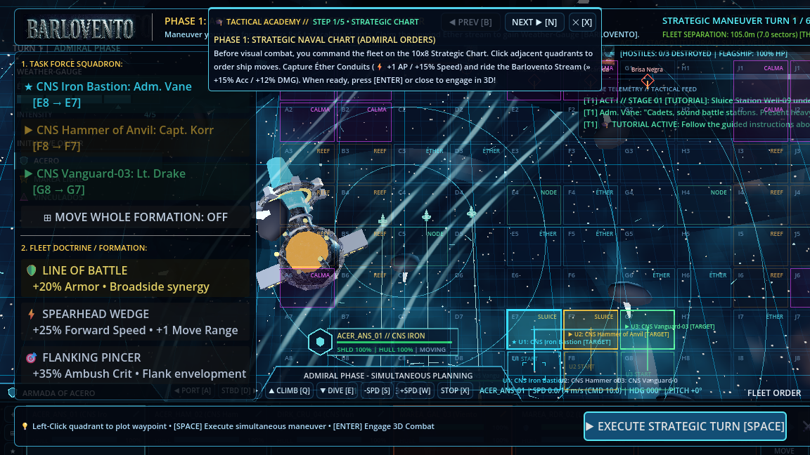
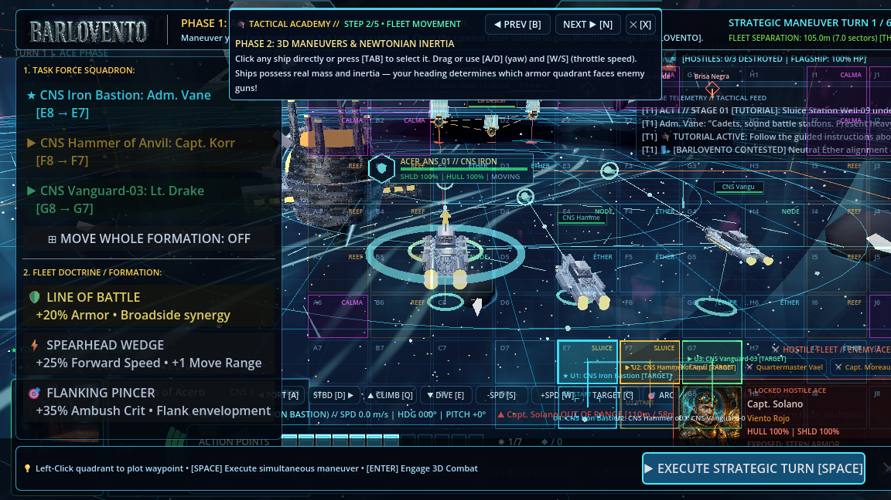
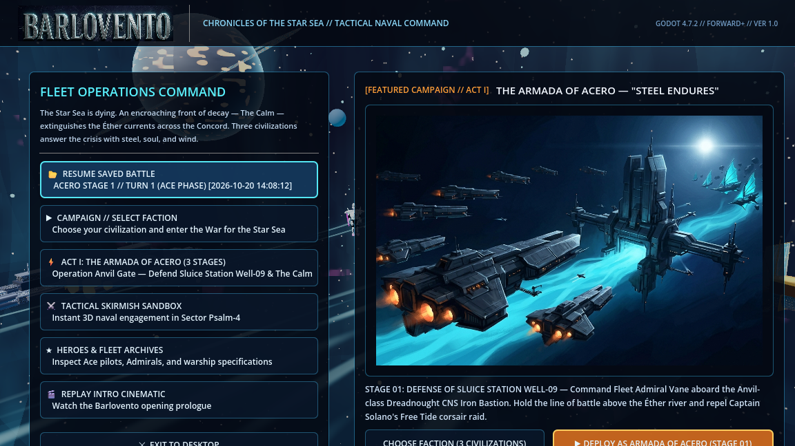
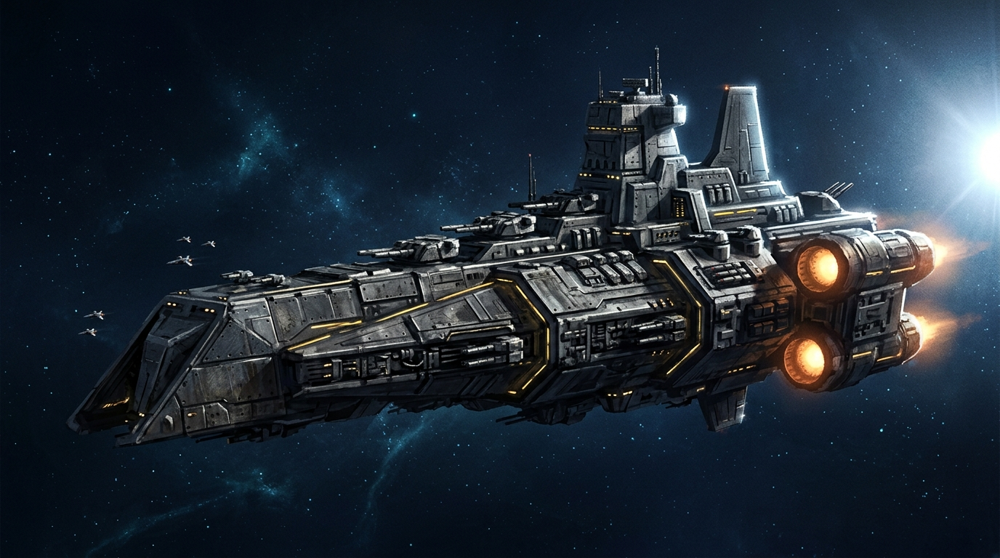
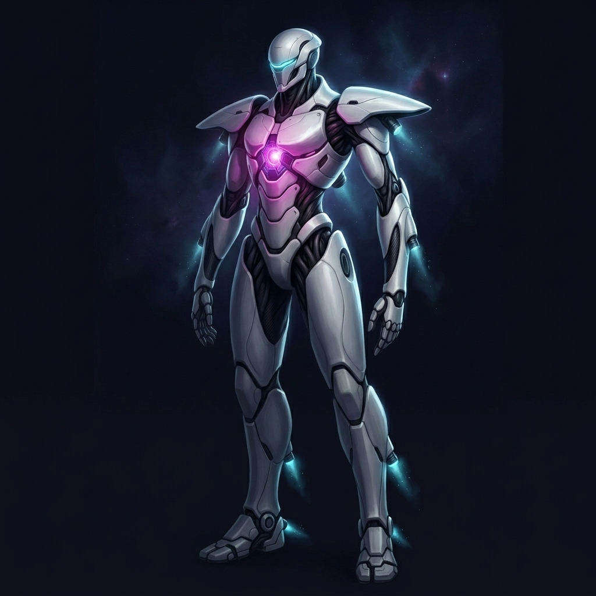
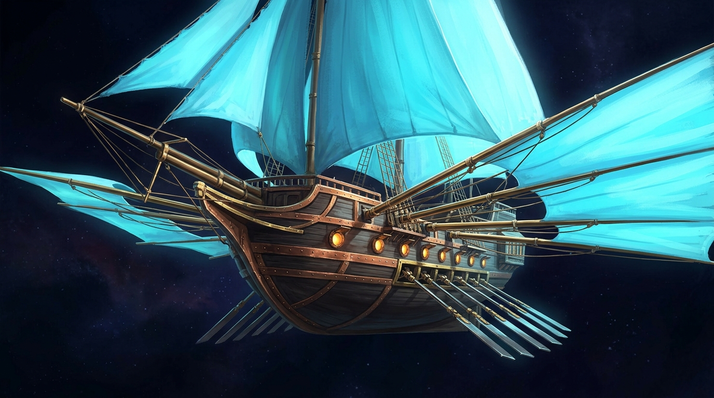

<p align="center">
  <a href="https://raestrada.github.io/barlovento/">
    
  </a>
</p>

<p align="center">
  
</p>

<p align="center">
  <a href="https://github.com/raestrada/barlovento/releases/download/v0.2.0-alpha/Barlovento.zip"></a>
  <a href="https://raestrada.github.io/barlovento/"></a>
  
  
  
</p>

<p align="center">
  <b>Space is not empty. It is an ocean — and its tide is going out.</b><br/>
  <em>A 3D turn-based space strategy game where naval momentum, simultaneous fleet planning, and Gundam-style hero aces collide.</em>
</p>

> [!IMPORTANT]
> **🎓 Interactive Tutorials are now LIVE!**
> The introductory training mission (Act I // Stage 01) is active for all three civilizations—**The Armada of Acero**, **The Vinculados**, and **The Free Tide**—featuring a guided **5-step Tactical Academy guide**, Newtonian maneuvering drills, active directional armor absorption, and rebalanced training duels.
>
> 🚀 **[Download Windows Alpha Build (Barlovento.zip)](https://github.com/raestrada/barlovento/releases/download/v0.2.0-alpha/Barlovento.zip)** • [View GitHub Releases](https://github.com/raestrada/barlovento/releases)

<p align="center">
  <a href="https://raestrada.github.io/barlovento/"><b>Explore the Interactive Web Experience & Watch the Cinematic Prologue &rarr;</b></a>
</p>

---

## Overview

**BARLOVENTO** transposes the tactical weight of age-of-sail naval warfare into the 3D vacuum of the **Star Sea** (*Mar Estelar*). Ships possess true **mass**, **inertia**, **momentum**, and **facing**—there are no magical friction brakes or instantaneous turns. Positioning, firing arcs, and vector drift matter as much as raw firepower.

The battle is fought across **two symbiotic phases**:
1. **The Admiral Phase (Simultaneous Strategy):** Blind vector planning across an 80-quadrant (10×8) tactical chart where commanders contest Éther Conduits, Barlovento Wind Streams, and Basalt Reefs.
2. **The Ace Phase (Turn-Based Tactics):** Ship-by-ship, meter-by-meter 3D dogfighting where players manage Action Points (AP), trigger broadside volleys, and master directional armor defense alongside a hand-picked squadron of hero aces.

---

## Design Pillars

1. **Newtonian Vector Movement** &mdash; You command acceleration vectors and heading adjustments, never teleporting to waypoints. Drift is an active tactical weapon, not an animation loop.
2. **Two-Phase Combat Loop (50/50 Balance)** &mdash; Simultaneous grand-fleet positioning followed by granular tactical dogfighting. Brilliant tactics can rescue a compromised approach; strategic foresight can trap an agile ace.
3. **Positioning & Spatial Geometry** &mdash; Full 3D sphere with a free camera. Directional armor, firing arcs, spinal batteries, and hull mass dictate every exchange.
4. **Inertia as an Adversary to Master** &mdash; Capital dreadnoughts commit kilometers before impact; ace interceptors dance along drifting momentum vectors.

---

## Real In-Engine Gameplay & Tactical Theater

<table>
  <tr>
    <td align="center" width="33%">
      <br/>
      <b>Phase 1 &bull; 10×8 Strategic Chart</b><br/>
      <em>Contested Éther Conduits, Barlovento streams &amp; Tactical Academy tutorial.</em>
    </td>
    <td align="center" width="33%">
      <br/>
      <b>Phase 2 &bull; 3D Ace Tactical Combat</b><br/>
      <em>Newtonian inertia, Action Points (AP), and live directional armor widgets.</em>
    </td>
    <td align="center" width="33%">
      <br/>
      <b>Campaign &bull; Faction Academy</b><br/>
      <em>Three asymmetric civilizations with dedicated tutorial stages.</em>
    </td>
  </tr>
</table>

### Phase 1 &mdash; The Approach (Admiral Phase)
Both fleets issue movement and combat orders concurrently across the 10×8 sector grid. Course, burn percentage, formation lock, and target bearings are planned simultaneously. Capture contested Éther Conduits for +1 AP / +15% Speed, surf the Barlovento stream for +15% hit accuracy, or ambush from basalt asteroid reefs before initiating visual combat.

### Phase 2 &mdash; The Engagement (Ace Phase)
Combat transitions to turn-based tactical maneuvering in full 3D space:
- **Vector Drift:** Ships carry velocity vectors across turns; changing direction requires dedicated retro-thrust burns.
- **Directional Armor Absorption:** Hull integrity is tracked across Bow, Port, Starboard, and Stern quadrants. Angling sloped prow armor absorbs kinetic impacts, while stern rakes deal lethal critical damage.
- **Action Point Management:** Spend AP each round on tactical abilities: Broadsides (+18% DMG), Oar Bursts, Shield Barriers, and RCS burns.
- **Mobile Suit Interception:** Aces fly independent vector lines, using vernier thrusters to slip into capital ship blind spots and breach spinal casemates.

---

## Three Asymmetric Civilizations

The Star Sea is saturated with **the Éther** (the "wind")—a field of dark energy that makes vacuum navigation possible. A spreading wavefront of decay, **the Calm**, is freezing the sea into dead, unnavigable stillness. Three civilizations answer the crisis with incompatible doctrines:

<table>
  <tr>
    <th width="33%">The Armada of Acero</th>
    <th width="33%">The Vinculados</th>
    <th width="33%">The Free Tide</th>
  </tr>
  <tr>
    <td align="center">
      <br/>
      <b>Doctrine &bull; Steel</b><br/>
      <em>"Dam and control the wind."</em>
    </td>
    <td align="center">
      <br/>
      <b>Doctrine &bull; Soul</b><br/>
      <em>"Transcend before the silence."</em>
    </td>
    <td align="center">
      <br/>
      <b>Doctrine &bull; Wind</b><br/>
      <em>"Re-awaken the dying sea."</em>
    </td>
  </tr>
  <tr>
    <td>
      <b>Aesthetic:</b> Brutalist hard-science navy. Chamfered hull plating, triple-barrel superfiring turrets, prow rams, and glowing amber intake conduits.<br/><br/>
      <b>Combat Style:</b> Unyielding line battle, long-range kinetic bombardment, heavily armored sponsons.
    </td>
    <td>
      <b>Aesthetic:</b> Biomechanical Gundam-style Mobile Suits. Contoured ceramic armor, V-Fin sensor crests, articulated dorsal wing-binders, and glowing soul cores.<br/><br/>
      <b>Combat Style:</b> Extreme zero-G agility, resonance beam lances, angular shields, neural duelists.
    </td>
    <td>
      <b>Aesthetic:</b> Steampunk void corsairs. Curved mahogany timbers, burnished brass ribs, glowing Éther-oars, and billowing turquoise quantum sails.<br/><br/>
      <b>Combat Style:</b> Solar-wind sailing, rapid outrigger flanking, close-quarters boarding raids.
    </td>
  </tr>
</table>

---

## Cinematic Prologue & Audio Architecture

BARLOVENTO features an official AAA **1080p Full HD Prologue** (`assets/video/intro.mp4` / `assets/video/intro.ogv`) engineered natively in 3D:

- **Unbroken Camera Choreography:** Seamless one-shot transition tracking from the quiet standoff in The Calm into the chaotic wide-angle fleet battle as Vinculados interceptors streak past the camera, culminating in a celestial tilt-up into the title reveal.
- **Symphonic Score & Sound Design:** Real 48 kHz stereo acoustic mastering combining Holst's *The Planets* (*Venus* & *Mars*) with stereo-panned vernier flybys, heavy naval laser discharges, and resonant title braams.
- **Algorithmic Hard-Surface Modeling:** Multi-station procedural lofting pipeline in Blender 5.2 producing concept-accurate PBR warship hulls, articulated Mobile Suit skeletons, and cratered basalt asteroid fields.

---

## Technology Stack

| Component | Specification | Description |
| :--- | :--- | :--- |
| **Engine** | Godot 4.7.2-stable | Modern Forward+ Clustered 3D Renderer |
| **Language** | GDScript | Strict typing, event-driven game state machines |
| **3D Pipeline** | Blender 5.2 LTS | Python-driven procedural hard-surface lofting & PBR node graphs |
| **Video Delivery** | H.264 MP4 / Theora OGV | Dual-format 1080p24 video stream with `+faststart` web streaming |
| **Audio Format** | 48 kHz / 16-bit Stereo PCM | Mastered orchestral score and acoustic Foley SFX |
| **CI / CD** | GitHub Pages & Actions | Automated web deployment on push to `main` |

---

## Repository Layout

```
barlovento/
├── index.html                # Official promotional website (GitHub Pages)
├── README.md                 # Project documentation & flagship overview
├── project.godot             # Godot engine project definition
├── AGENTS.md                 # Single source of truth & operating manual for AI agents
├── .github/
│   └── workflows/
│       └── pages.yml         # GitHub Actions automated Pages deployment
├── assets/
│   ├── brand/                # Canonical logo (logo.png) & iconography
│   ├── splash/               # Cover art & promotional banners
│   ├── mockups/              # UI mockups (Admiral Phase, Ace Phase, Roster)
│   ├── ships/                # Concept art & hull textures (Acero, Vinculados, Marea)
│   ├── video/                # Master cinematic video (intro.mp4 & intro.ogv)
│   └── audio/                # Mastered 48kHz soundtrack & sound effect libraries
├── docs/
│   ├── DESIGN.md             # Full game design document & lore bible
│   ├── TECH.md               # Technology architecture & mathematical models
│   ├── narrative/            # Campaign narrative, acts & faction progression
│   ├── factions/             # Per-faction military deep-dives
│   └── art/                  # Art direction, consistency guidelines & prompts
├── scenes/                   # Godot 3D scene files (.tscn)
├── scripts/                  # GDScript game logic & entity controllers
└── tools/                    # Video rendering, procedural audio & asset pipelines
```

---

## Getting Started

### Prerequisites
- **Godot Engine 4.7.2-stable** (Forward+ rendering support)
- **Blender 5.2 LTS** (required only for rebuilding procedural 3D cinematics)
- **Python 3.10+** with `numpy` and `scipy` (for audio mastering pipelines)

### Launching the Project
1. Clone the repository:
   ```bash
   git clone https://github.com/raestrada/barlovento.git
   cd barlovento
   ```
2. Open with Godot:
   ```bash
   godot --path .
   ```
3. Run headless verification:
   ```bash
   godot --headless --path . --quit
   ```

---

## Community & Development

BARLOVENTO is an exploration in high-fidelity agentic game development, built end-to-end with reproducible text, scripts, and algorithms.

- **Author:** [Rodrigo Estrada (raestrada)](https://github.com/raestrada)
- **Live Landing Page:** [https://raestrada.github.io/barlovento/](https://raestrada.github.io/barlovento/)
- **Documentation:** [`docs/DESIGN.md`](docs/DESIGN.md) &bull; [`docs/TECH.md`](docs/TECH.md)

<p align="center">
  <em>Fight for the weather gauge.</em><br/>
  <b>BARLOVENTO</b>
</p>
