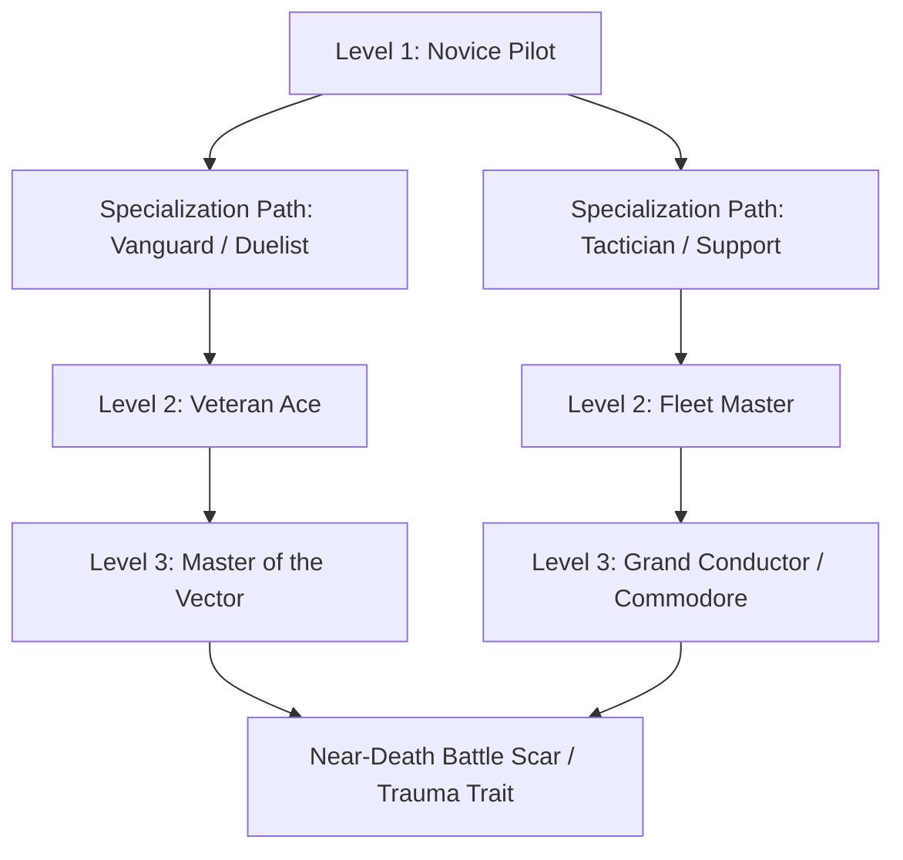

# BARLOVENTO — Campaign Progression & Persistence Systems

> **Purpose:** Technical and systemic specification for fleet persistence, ace hero RPG progression, difficulty calibration, and post-battle economies.  
> **Alignment:** Follows [`docs/DESIGN.md`](file:///w:/home/rodrigoestrada/workspace/github.com/raestrada/barlovento/docs/DESIGN.md) §6 and §10.

---

## 1. Fleet Persistence Architecture (The "Homeworld Rule")

### 1.1 Persistent Unit State Schema
Between missions, surviving hulls do not reset to full health or default ammunition. Every line ship, escort, and strike carrier records its exact tactical state at the moment of mission victory into a persistent save dictionary.

```gdscript
# Persistent Ship State Data Structure
var persistent_ship_state = {
    "ship_id": "crucible_04",
    "class_name": "Crucible",
    "faction": "acero",
    "hull_hp": 850,              # Out of 1200 max
    "armor_facings": {
        "bow": 450,              # Out of 500
        "port": 120,             # Out of 300 (Breached)
        "starboard": 280,        # Out of 300
        "stern": 50              # Out of 150 (Critical)
    },
    "subsystems": {
        "main_battery": 1.0,     # 100% operational
        "maneuver_thrusters": 0.65, # Damaged, -35% turn rate
        "point_defense": 0.0     # Destroyed
    },
    "crew_veterancy": {
        "rank": 2,               # 0: Green, 1: Regular, 2: Veteran, 3: Elite
        "xp": 340,
        "kills": 8
    },
    "ammunition": {
        "mass_driver_slugs": 140, # Out of 250
        "countermeasures": 2     # Out of 8
    }
}
```

### 1.2 Veterancy Ranks & Modifiers
Crew survival across consecutive battles confers substantial combat bonuses:

| Veterancy Rank | Battles Survived | Bonuses Awarded |
|---|---|---|
| **Rank 0: Recruit** | 0 | Baseline stats. +10% panic probability under critical fire. |
| **Rank 1: Line Regular** | 1–3 | Baseline stats. Normal response times. |
| **Rank 2: Combat Veteran** | 4–7 | +10% gunnery accuracy, +15% damage control repair rate, +1 thruster burn efficiency. |
| **Rank 3: Elite Line** | 8+ | +20% gunnery accuracy, immune to crew panic, unlocks elite tactical maneuver per hull class. |

---

## 2. Ace Hero Pilot Progression (The XCOM Loop)

Each faction features a core roster of 2 to 4 named Ace Heroes who command signature flagships, assault frigates, or mobile frames.



### 2.1 Ace Skill Trees (3 Tiers)

#### Acero Ace: Strike Ace (Vesper Cruz)
- **Tier 1 (Initiate):**
  - *Newtonian Snap-Turn:* Instant 90° heading change with zero drift bleed (Cooldown: 3 turns).
  - *Hardpoints Overcharge:* +20% mass-driver velocity for 2 turns.
- **Tier 2 (Veteran):**
  - *Stern Knifing:* Attacks against capital stern facings deal +50% critical damage to engines.
  - *Interception Web:* Automatic point-defense overwatch against torpedoes within 4 hexes.
- **Tier 3 (Grand Ace):**
  - *Omega Strafe:* High-speed linear pass firing through multiple targets in a single vector line.

#### Vinculados Ace: Linked Ace (Kaelen-7)
- **Tier 1 (Initiate):**
  - *Resonant Evasion:* +30% dodge against ballistic fire while moving at speed $\ge 3$.
  - *Thought-Speed Burn:* +2 Action Points on turns where shield is undamaged.
- **Tier 2 (Veteran):**
  - *Severing Beam:* Focused beam weapon that cuts through facing armor without damage falloff.
  - *Harmonic Shield Pulse:* Transfers 50% frame shield to an adjacent ally.
- **Tier 3 (Grand Ace):**
  - *Resonance Nova:* Releases an omnidirectional psychic shockwave that disables missile guidance and stuns enemy pilots in a 3-hex radius.

#### Free Tide Ace: Windrider Captain (Mateo Solano)
- **Tier 1 (Initiate):**
  - *Catch the Gust:* Gains +2 free movement hexes whenever entering an éteron current line.
  - *Full Canvas:* Deploys auxiliary sail area to double braking deceleration.
- **Tier 2 (Veteran):**
  - *Weather Gauge Mastery:* +25% broadside damage when attacking from the windward quadrant.
  - *Grapple Barrage:* Fires four magnetic tethers simultaneously to anchor a fleeing enemy.
- **Tier 3 (Grand Ace):**
  - *Roar of the Sea:* Calls a temporary current vector into existence across the entire tactical grid for 2 turns.

### 2.2 Battle Scars & Trauma System
When an Ace is reduced to 0 HP, they do not immediately perish. A survival check is made based on fleet proximity:
- **Catastrophic Death (30% chance):** The Ace is lost forever (permadeath).
- **Severe Trauma (70% chance):** The Ace survives with a permanent psychological or physical scar:
  - *Phantom Drift:* -10% turn rate, but gains +15% radar awareness due to paranoia.
  - *Nerve Fry (Vinculados):* Resonance ceiling capped at 80%, but immune to psychological stun.
  - *Timber Splinter (Free Tide):* Crew operates at -1 speed, but hull resists boarding actions by +40%.

---

## 3. Post-Battle Economy & Salvage Mechanics

After each scenario, players enter the **Fleet Readiness Phase**:

```
[ Mission Victory ]
       │
       ├──> Wreckage Salvage ──> Raw Materials & Technology Databanks
       │
       ├──> Captured Hulls ──> Option A: Commission into Fleet (Repair Cost)
       │                   └──> Option B: Scuttle for Refined Parts & Fuel
       │
       └──> Crew Triage ──> Medical Bay Treatment (Heal Scars / Replenish Crew)
```

### 3.1 Faction-Specific Logistics Currencies
- **Armada of Acero:**
  - *Refined Éteron (Fuel/Energy):* Consumed by reactor burns, repairs, and shield generators.
  - *Tungsten Plates:* Used to replace stripped hull facings.
- **The Vinculados:**
  - *Resonance Crystals:* Extracted from pristine fields; required to calibrate neural conduits and awaken new frames.
  - *Bio-Ceramic Synapses:* Used to heal pilots and repair frame musculature.
- **The Free Tide:**
  - *Treated Ironwood & Copper Rivets:* Used to patch wooden hulls and seal airlocks.
  - *Quantum Canvas Membranes:* Spliced onto sail booms to restore lost sail thrust area.

---

## 4. Difficulty Calibration & Adaptive Threat Scaling

To achieve a true *Homeworld*-grade tactical challenge:

1. **No Hand-holding Autowin:** If a player loses their heavy capital ships in Mission 04, they must endure Mission 05 with their surviving cruisers and escorts.
2. **Dynamic Fleet Scaling Factor ($S_f$):**
   $$\text{Enemy Reinforcements} = \text{Base Encounter} \times \left(1.0 + 0.15 \times \frac{\text{Player Fleet Strength}}{\text{Expected Baseline}}\right)$$
   - Players who play exceptionally well and hoard massive fleets face larger, more challenging enemy strike wings.
   - Players struggling with heavy losses receive slightly sparser enemy compositions to prevent unwinnable campaign deadlock, while still maintaining high tension.
3. **The Calm Hazard Clock:** Several missions feature the **Calm Wavefront**, an environmental timer that systematically destroys the tactical grid from one flank. Players cannot turtle indefinitely—they must execute their maneuvers under constant spatial pressure.
